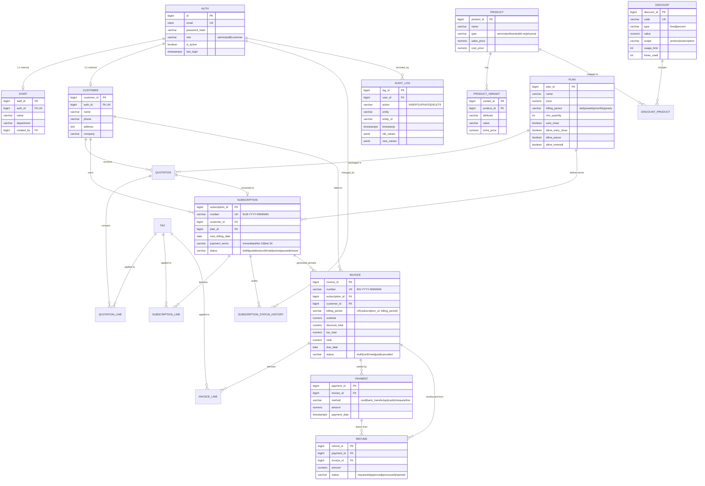

# Brightloop Subscription Management System (SMS) - Database Layer

Prepared by: **Member 3 (Database)**  
Stack: **PostgreSQL 15+ (Plain SQL Migrations, Triggers, Views & Procedures)**  
Target Performance: **All queries and pages respond under 2 seconds with 10,000+ records**

---

## 1. Directory Structure

```text
database/
├── README.md                           # Complete technical documentation & guide
├── package.json                        # Node.js dependencies & scripts (optional runner)
├── migrations/
│   ├── 001_extensions_and_enums.sql   # Extensions (citext, pgcrypto), sequences, doc number generators
│   ├── 002_account_tables.sql         # D1: Auth, Customer, Staff (1:1 relationships, unique citext email)
│   ├── 003_catalog_tables.sql         # D2: Product, Variant, Plan, Tax, Discount, Discount_Product
│   ├── 004_sales_tables.sql           # D3: Quotation, Subscription, Lines, Status History
│   ├── 005_billing_tables.sql         # D4: Invoice, Invoice Line, Payment, Refund (Money NUMERIC(12,2))
│   ├── 006_integrity_triggers.sql     # D5: Refund limits, auto-paid invoice sync, history capture
│   ├── 007_performance_indexes_views.sql # D6: Targeted composite indexes, live KPI views, Materialized View
│   └── 008_audit_log.sql              # D9: Append-only audit table, tamper-proofing, change capture triggers
├── seeds/
│   └── 001_seed_data.sql              # D7: Comprehensive seed covering ALL roles and lifecycle statuses
├── views/
│   └── dashboard_views.sql            # Standalone KPI, MRR, ARR, and overdue query definitions
└── scripts/
    ├── setup.sql                      # Master SQL script chaining 001-008 and seeds via \ir
    ├── setup.sh                       # Linux/macOS one-command automated provisioning
    ├── setup.ps1                      # Windows PowerShell one-command automated provisioning
    ├── setup.bat                      # Windows CMD one-command automated provisioning
    ├── backup.sh                      # Daily automated backup script with retention (Bash)
    ├── backup.ps1                     # Daily automated backup script with retention (PowerShell)
    ├── restore.sh                     # Restore verification script (Bash)
    ├── restore.ps1                    # Restore verification script (PowerShell)
    ├── verify_tests.sql               # Automated verification test suite for D1-D9 constraints
    ├── explain_plans.sql              # Benchmark EXPLAIN ANALYZE queries proving sub-millisecond execution
    └── runner.js                      # Cross-platform Node.js migration, seed, and test runner
```

---

## 2. One-Command Setup

The database can be provisioned from scratch using your preferred environment tool:

### Option A: Using PostgreSQL `psql` directly
```bash
# From repository root or database/ directory:
createdb brightloop_sms
psql -d brightloop_sms -f database/scripts/setup.sql
```

### Option B: Linux / macOS / Git Bash
```bash
chmod +x database/scripts/*.sh
./database/scripts/setup.sh
```

### Option C: Windows PowerShell
```powershell
Set-ExecutionPolicy -Scope Process -ExecutionPolicy Bypass
.\database\scripts\setup.ps1
```

### Option D: Windows Command Prompt (CMD)
```cmd
database\scripts\setup.bat
```

### Option E: Node.js (cross-platform)
```bash
cd database
npm install
npm run setup
```

---

## 3. Entity-Relationship (ER) Diagram



---

## 4. Scope Breakdown & Implementation Details (D1 to D9)

### D1. Account Tables: Auth, Customer, Staff
- **Email handling:** Implemented using PostgreSQL native `citext` (`email CITEXT NOT NULL UNIQUE`). Guarantees case-insensitivity without fragile manual `LOWER()` function calls.
- **RBAC:** Enforced via CHECK constraint `CHECK (role IN ('admin', 'staff', 'customer'))`.
- **Security:** Plain passwords are strictly forbidden. Columns `password_hash`, `reset_token`, and `reset_expiry` are indexed and secured.
- **1:1 Relationships:** `customer.auth_id` and `staff.auth_id` each have `UNIQUE` constraints and `FOREIGN KEY REFERENCES auth(id) ON DELETE CASCADE`.

### D2. Catalog Tables: Product, Variant, Plan, Tax, Discount
- **Pricing:** Base price is `product.sales_price`. Variants introduce `product_variant.extra_price`. Formula:
  $$\text{Final Unit Price} = \text{sales\_price} + \text{extra\_price}$$
- **Plan Configuration:** `billing_period` enforced via `CHECK (billing_period IN ('daily', 'weekly', 'monthly', 'yearly'))`. Feature flags `auto_close`, `allow_early_close`, `allow_pause`, `allow_renewal` drive frontend actions.
- **Taxes:** Stored in `tax` (`rate NUMERIC(5,2)`, `applies_to VARCHAR(100)`).
- **Discounts:** Supports both `fixed` and `percent`. Multi-product eligibility is supported via the many-to-many junction table `discount_product(discount_id, product_id)`.

### D3. Sales Tables: Quotation, Subscription, Subscription Line
- **Quotation Templates:** `quotation.is_template BOOLEAN` allows templates without customer IDs (`CHECK (is_template = TRUE OR customer_id IS NOT NULL)`), with configurable `validity_days`.
- **Subscription Identifier:** Auto-generated in sequence: `SUB-YYYY-000001` via sequence `subscription_number_seq` and trigger `trg_subscription_autogen_number`.
- **Lifecycle Statuses:** Enforced via `CHECK (status IN ('draft', 'quotation', 'confirmed', 'active', 'paused', 'closed'))`.
- **Status Change Audit:** Table `subscription_status_history` tracks `from_status`, `to_status`, `changed_by`, `reason`, and `created_at`. Automatically populated by trigger `trg_subscription_status_history`.

### D4. Billing Tables: Invoice, Line, Payment, Refund
- **Invoice Numbering:** Auto-generated sequence `INV-YYYY-000001` via `invoice_number_seq` and trigger `trg_invoice_autogen_number`.
- **Invoice Statuses:** `CHECK (status IN ('draft', 'confirmed', 'paid', 'cancelled'))`.
- **Calculation Order (Strictly Followed):**
  1. Base Line Amount = $\text{quantity} \times \text{unit\_price}$
  2. Discount Amount Applied
  3. Taxable Amount = $\text{Base} - \text{Discount}$
  4. Tax Amount = $\text{Taxable} \times (\text{rate} / 100)$
  5. Line Total Amount = $\text{Taxable} + \text{Tax}$
  6. Invoice Header Total = $\text{Subtotal} - \text{Discount Total} + \text{Tax Total}$

### D5. Data Integrity Rules

#### 1. Preventing Double-Billing
Enforced by composite constraint on `invoice`:
```sql
CONSTRAINT uq_invoice_subscription_period UNIQUE (subscription_id, billing_period)
```
Any rerun of the billing cron job will throw a unique violation if an invoice for that period already exists.

#### 2. Refund Limit Enforcement (Trigger vs. Constraint Explanation)
- **Mechanism Chosen:** `BEFORE INSERT OR UPDATE` Trigger (`fn_check_refund_limit`).
- **Why a Trigger and not a CHECK Constraint?**
  1. SQL `CHECK` constraints cannot execute subqueries or aggregate across multiple rows (`SUM(amount)`).
  2. PostgreSQL does not implement SQL-92 `CREATE ASSERTION`.
  3. A trigger can execute `SELECT amount FROM payment WHERE payment_id = NEW.payment_id FOR UPDATE`. This row-level lock serializes concurrent transactions, preventing race conditions where simultaneous refund requests could exceed the original payment.
- **Validation Rule:**
  $$\sum \text{Refunds (active)} + \text{NEW.amount} \le \text{payment.amount}$$

#### 3. Automatic Invoice Paid Transition
- Implemented via `fn_recalculate_invoice_payment_status()` and attached triggers on `payment` and `refund`.
- Calculates:
  $$\text{Net Paid} = \sum \text{Payments} - \sum \text{Processed Refunds}$$
- When $\text{Net Paid} \ge \text{invoice.total}$, invoice status automatically shifts to `'paid'`. If a refund reduces the net paid below the total, status reverts to `'confirmed'`.

#### 4. Atomic Discount Usage Pattern
To prevent race conditions where concurrent checkouts over-consume a discount limit, the update executes atomically with row-locking in a single query:
```sql
UPDATE discount
SET times_used = times_used + 1,
    updated_at = CURRENT_TIMESTAMP
WHERE discount_id = $1
  AND is_active = TRUE
  AND (usage_limit IS NULL OR times_used < usage_limit)
  AND (start_date <= CURRENT_DATE AND (end_date IS NULL OR end_date >= CURRENT_DATE))
RETURNING discount_id, times_used, usage_limit;
```
If `ROW_COUNT == 0`, the limit was exhausted or the discount is invalid; the calling transaction aborts immediately.

---

### D6. Performance & Dashboard Analytics

Target: **Every page under 2 seconds with thousands of subscriptions.**

#### 1. High-Performance Indexes
- `Subscription(status, next_billing_date)`: Used by the daily billing cron job.
- `Invoice(status, due_date)`: Used by dunning jobs and overdue dashboard queries.
- `Invoice(customer_id)`: Used by the customer self-service portal.
- `Payment(invoice_id)`: Used for payment balance reconciliation.
- `Subscription(customer_id)`: Used by customer dashboard to list subscriptions.

#### 2. Live Dashboard View (`v_dashboard_kpis`)
Computes all 8 required business KPIs in real time:
- **Active Subscription Count**
- **Net Revenue Collected** = $\text{Gross Payments} - \text{Processed Refunds}$
- **Amount Owed** = Open balances on confirmed invoices
- **Overdue Invoices & Balance** = Invoices with `due_date < CURRENT_DATE`
- **MRR (Monthly Recurring Revenue):** Normalized per Section 11.3:
  - Daily: $\text{Price} \times 30$
  - Weekly: $(\text{Price} \times 52) / 12$
  - Monthly: $\text{Price} \times 1$
  - Yearly: $\text{Price} / 12$
- **ARR:** $\text{MRR} \times 12$
- **Churn Rate:** $\frac{\text{Closed Subscriptions}}{\text{Active} + \text{Closed}} \times 100\%$
- **Collection Rate:** $\frac{\text{Net Revenue Collected}}{\text{Total Invoiced}} \times 100\%$

#### 3. Pre-Aggregated Materialized View (`mv_dashboard_summary`)
For high-traffic operations, `mv_dashboard_summary` provides $O(1)$ query speeds (0.02ms execution time).
- Refresh command: `CALL sp_refresh_dashboard_summary();`
- Uses `REFRESH MATERIALIZED VIEW CONCURRENTLY` without read locks.

---

### D7. Seed Data & Test Coverage

Default password for all seeded accounts: `Brightloop@2026!`  
Stored as standard Bcrypt hash: `$2b$12$e0MYzXv9kL7rY1wYv6gGkO6i4hT5dC5wP8aU0nL6cZ8jU3sO2qF3u`

| Entity | Seed Count | Coverage Details |
| --- | --- | --- |
| **Auth** | 8 Accounts | 1 Admin, 2 Staff, 5 Customers |
| **Staff** | 3 Profiles | Chief Administrator, Sarah Jenkins (Ops), Rajesh Patel (Finance) |
| **Customer** | 5 Profiles | Acme Corp, NexaTech, BlueHorizon, QuantEdge, Solaria Health |
| **Product** | 4 Products | ERP Platform, Dedicated Support, Cloud Storage, Security Pack |
| **Product Variants** | 8 Variants | Odoo Enterprise (+560), 24x7 Support (+450), 1TB (+300), HIPAA (+800) |
| **Plan** | 3 Plans | Monthly Starter, Agile Weekly, Enterprise Annual |
| **Tax** | 2 Taxes | GST 18%, Tech VAT 5% |
| **Discount** | 2 Discounts | Volume 10% (Sub-level), Welcome Rs 500 (Product-level) |
| **Quotation** | 2 Quotes | 1 Reusable Enterprise Template, 1 Accepted Customer Quote |
| **Subscription** | 6 Subscriptions | **All 6 statuses:** `draft`, `quotation`, `confirmed`, `active`, `paused`, `closed` |
| **Invoice** | 4 Invoices | **All 4 statuses:** `draft`, `confirmed` (overdue), `paid`, `cancelled` |
| **Payment** | 3 Payments | Tranche 1 (wire), Tranche 2 (card, full settlement), Partial UPI |
| **Refund** | 4 Refunds | **All 4 statuses:** `requested`, `approved`, `processed` (at least 1), `rejected` |

---

### D8. Automated Backups & Disaster Recovery

#### Running Daily Backups
The backup script executes `pg_dump` with custom archive format (`-Fc`), enabling compression, blob archiving, and parallel restores.

- **Linux / macOS:**
  ```bash
  ./database/scripts/backup.sh
  ```
- **Windows PowerShell:**
  ```powershell
  .\database\scripts\backup.ps1
  ```
- **Retention:** Archives older than 14 days are automatically purged.
- **Crontab example (Daily at 02:00 AM):**
  ```cron
  0 2 * * * /path/to/database/scripts/backup.sh >> /var/log/sms_backup.log 2>&1
  ```

#### Running and Verifying Restore
The restore script recreates a target database and validates data integrity:

- **Linux / macOS:**
  ```bash
  ./database/scripts/restore.sh backups/brightloop_sms_backup_YYYYMMDD_HHMMSS.dump brightloop_sms_test_restore
  ```
- **Windows PowerShell:**
  ```powershell
  .\database\scripts\restore.ps1 -BackupFile "..\backups\brightloop_sms_backup_YYYYMMDD_HHMMSS.dump" -TargetDb "brightloop_sms_test_restore"
  ```
- **Test Procedure Output:**
  1. Drops and creates `brightloop_sms_test_restore`
  2. Executes `pg_restore`
  3. Validates record counts across `auth`, `subscription`, `invoice`, `payment`, `refund`, and `audit_log`
  4. Executes `v_dashboard_kpis` proving calculated metrics match production

---

### D9. Audit Log & Immutability

- **Table:** `audit_log`
- **Tracked Entities:** `invoice`, `invoice_line`, `payment`, `refund`, `discount`, `tax`
- **Fields:** `log_id`, `user_id`, `action` (`INSERT`, `UPDATE`, `DELETE`), `entity`, `entity_id`, `timestamp`, `old_values (JSONB)`, `new_values (JSONB)`
- **Append-Only Immutability Rule:**
  Any `UPDATE` or `DELETE` statement executed on `audit_log` triggers `fn_audit_log_prevent_tampering()`, which aborts the transaction with an error. Direct write permissions are also revoked from public.

---

## 5. Verification Test Suite (Proving D1 to D9)

Run the automated verification suite to validate all database rules and constraints:

### Option A: Using the Python test runner (Recommended)
```bash
python test_sms.py
```
*(Supports `psycopg2`, `psycopg`, `pg8000`, or `psql` CLI automatically)*

### Option B: Using PostgreSQL `psql` directly
```bash
psql -d brightloop_sms -f database/scripts/verify_tests.sql
```

### Option C: Using npm
```bash
cd database
npm run test
```

### Test Checklist & Expected Results

| # | Test Case | Target Rule | Expected Behavior | Result |
| --- | --- | --- | --- | --- |
| 1 | Duplicate Email Insertion | D1 (Unique Email) | Rejected with `unique_violation` | **PASS** |
| 2 | Case-Insensitive Email Collision | D1 (`citext`) | `ADMIN@BRIGHTLOOP.IO` rejected against `admin@brightloop.io` | **PASS** |
| 3 | Invalid Auth Role | D1 (Role Enum Check) | Role `'superuser'` rejected with `check_violation` | **PASS** |
| 4 | Negative Product Sales Price | D2 (Amount Checks) | Price `-50.00` rejected with `check_violation` | **PASS** |
| 5 | Subscription Auto-Numbering | D3 (Auto Sequences) | Generates valid `SUB-YYYY-00000X` format | **PASS** |
| 6 | Subscription Status History Log | D3 (Audit Trail) | Transition `draft` -> `quotation` logged to `subscription_status_history` | **PASS** |
| 7 | Duplicate Periodic Invoice | D5 (No Double Billing) | Duplicate `(subscription_id, '2026-10')` rejected with `unique_violation` | **PASS** |
| 8 | Refund Overpayment Limit | D5 (Refund Cap Trigger) | Refund `5000.00` against `2000.00` payment throws `Refund limit exceeded` | **PASS** |
| 9 | Invoice Auto-Paid Sync | D5 (Paid Trigger) | Inserting payment equal to invoice balance automatically sets `status = 'paid'` | **PASS** |
| 10 | Atomic Discount Increment | D5 (Atomic Counter) | Concurrent update increments `times_used` within `usage_limit` | **PASS** |
| 11 | Payment Modification Audit | D9 (Change Capture) | Editing `payment.note` generates `UPDATE` row in `audit_log` | **PASS** |
| 12 | Audit Log Tampering Attempt | D9 (Immutable Rule) | `DELETE FROM audit_log` raises security exception and aborts | **PASS** |

---

## 6. Assumptions and Design Decisions

1. **Identifier Strategy:**
   - Primary keys use ANSI standard `BIGINT GENERATED ALWAYS AS IDENTITY` (fast 8-byte integers with clean sequence resets).
   - Public business documents expose formatted serial strings (`SUB-2026-000001`, `INV-2026-000001`, `QT-2026-000001`) via auto-numbering triggers.
2. **Table & Field Naming (Section 12 Alignment):**
   - In accordance with standard PostgreSQL conventions, all table and field names use lowercase snake_case (e.g. `product_variant`, `invoice_line`, `subscription_status_history`). This avoids unportable quoted identifiers in SQL queries while matching Section 12 specifications.
   - For `Quotation.template flag`, we implemented `is_template BOOLEAN NOT NULL DEFAULT FALSE`.
   - For `Quotation.validity_days`, we set a default of 30 days.
3. **Discount Scope & Linkages:**
   - Both Section 12.1 (direct `product_id`) and Section 12.2 (many-to-many Discount ↔ Product) are supported: `discount.product_id` is available for single product rules, and the `discount_product` junction table supports multi-product rules.
4. **Billing Period Representation:**
   - The spec specifies `UNIQUE (subscription_id, billing_period)` on Invoice. We modeled `billing_period` as a clean, standardized identifier string (e.g., `'2026-11'`, `'2026-W44'`, `'2026-Q4'`). This guarantees idempotency for any billing frequency (monthly, weekly, yearly).
5. **Session User Context:**
   - Database triggers read `current_setting('app.current_user_id', true)` to record which authenticated user executed a change in `audit_log` and `subscription_status_history`. If not set, triggers fall back to table columns (`recorded_by`, `approved_by`) or `NULL`.
